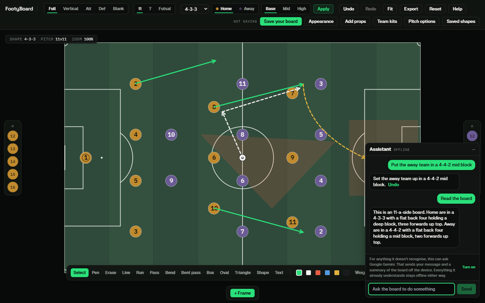

# FootyBoard

A browser-based soccer tactics board. Set up a formation, draw runs and passes, storyboard the movement across frames, export it, and work on it with other people in real time. Joining takes a link or a six-letter code, with no account required.

**Live:** [www.footyboard.me](https://www.footyboard.me)



## Features

**Board**

- Three pitch formats: 11-a-side, 7-a-side and futsal, with full, vertical, attacking-half, defending-half and blank views.
- Ten 11-a-side formation presets (4-4-2, 4-3-3, 4-2-3-1, 4-1-4-1, 3-5-2, 3-4-3, 5-3-2, 5-4-1, 4-4-1-1, 4-3-2-1), plus 7-a-side and futsal shapes, with base, mid and high blocks and automatic mirroring for the away side.
- Drag players, marquee-select and move groups, nudge with the arrow keys, rename and renumber, undo and redo.
- Drawing tools: pen, line, run and pass arrows, curved runs and bent passes, rectangle, oval, triangle and free polygon zones, and text labels. Everything stays editable after it is drawn and can be attached to a player.
- Frames for storyboarding a sequence of movements, with playback.
- Export to PNG, animated GIF or WebM.
- System, light and dark appearance. The pitch has its own theme, which is part of the board and is shared with everyone in the room.

**Collaboration**

- Live rooms over WebSockets: positions, drawings, formations and cursors sync between everyone on a board.
- Join by share link (`/board?board=<id>&share=<token>`) or by a six-letter code (`/join?code=ABCDEF`) that expires after twelve hours.
- A guest who joins with a code gets a real account with no email or password, and can attach credentials later without losing their boards.
- Owner controls: instructor mode (members can watch but not edit), anonymous presence, and removing a member.

**Assistant**

- A deterministic, rule-based parser handles commands such as "put the away team in a 4-4-2 mid block". It runs offline and costs nothing.
- An optional fallback to a Gemini model handles phrasings the parser does not recognise and answers tactical questions in prose. It is opt-in per user, sends only a summary of the board, and can only choose from a fixed list of functions that mirror the parser's own commands, so it has no way to do anything the parser cannot.

**Accounts**

- Email and password sign-in, optional two-step sign-in with an authenticator app and recovery codes, sign out everywhere, and account deletion.
- There is no password-reset email. Recovery is by a security question set at signup, and a second factor, if enabled, is still required to recover.

## Architecture

```
Browser (React, Konva canvas, Zustand)
   |  HTTPS: REST for accounts and board saves
   |  WSS:   ops relayed between everyone in a room
   v
Express API  ---- one or more instances ----+
   |                                        |
   |        PostgreSQL (the only datastore) |
   +-- sessions, boards (encrypted), shares |
   +-- rate limits and lockouts             |
   +-- LISTEN / NOTIFY: the room bus -------+
```

- **State lives in Postgres, not in process memory.** Sessions, rate limits and lockouts are rows, so any instance accepts any cookie and a limit holds across instances.
- **Rooms need no Redis.** An instance relays an op to its own sockets and publishes it with `pg_notify`; every other instance `LISTEN`s and relays to its sockets.
- **Ops carry outcomes, not intents.** The client runs the ordinary store action, then broadcasts the values it settled on, so peers apply results instead of re-deriving them and last-write-wins is correct by construction.
- **Boards are encrypted at rest** with AES-256-GCM. Board names are stored in the clear so the picker can sort without decrypting every row.

The full server design, endpoint table, and security notes are in [`server/README.md`](server/README.md).

## Tech stack

| Layer | |
| --- | --- |
| Frontend | React 19, TypeScript (strict), Vite 7, Tailwind CSS 3, Zustand, React Router 7 |
| Canvas and motion | Konva and react-konva for the board, Framer Motion, OGL (WebGL) on the landing page, gifenc for GIF export |
| Backend | Node.js (22.12 or newer), Express 5, ws, pg |
| Database | PostgreSQL. Development uses `embedded-postgres`, so there is no Docker and no system install |
| Tests | Vitest and Testing Library (client), the Node test runner against a real Postgres (server) |
| Lint | oxlint |

## Getting started

**Prerequisites:** Node.js 22.12 or newer. Nothing else: no Docker, no database to install.

```bash
npm install
npm --prefix server install
```

Run three processes, in this order, each in its own terminal:

```bash
# 1. Postgres on :55432. Downloads real binaries on first run.
npm --prefix server run db

# 2. The API on :8787 (one instance), or a cluster of three behind a balancer.
npm --prefix server start
npm --prefix server run cluster

# 3. The frontend on :5173. It proxies /api and /ws to the API.
npm run dev
```

Open <http://localhost:5173>. If saving appears broken, check that all three are running: a save needs both the API and Postgres.

## Configuration

The API reads `server/.env`. Copy [`server/.env.example`](server/.env.example) to get started; every value in it has a working development default, and each one is documented where it is declared.

In production the process refuses to boot rather than quietly downgrading. The ones that matter:

| Variable | Notes |
| --- | --- |
| `APP_ENV` | `development`, `test` or `production`. This is a security setting, not a label. An unrecognised value stops the boot. |
| `DATABASE_URL` | Required in production. Use the restricted runtime role from [`server/sql/runtime-role.sql`](server/sql/runtime-role.sql), not a superuser, and `sslmode=verify-full` for a remote database. |
| `SESSION_SECRET` | At least 32 characters. The placeholder is refused. |
| `ENCRYPTION_KEY` | 64 hex characters. **Losing or changing it makes every stored board permanently unreadable.** There is no re-encryption path, so keep a copy somewhere that survives the host. |
| `CORS_ORIGIN` | Exact origin or comma-separated list: scheme, host and port, no trailing slash. Must be `https` in production. |
| `TRUST_PROXY` | Set only if something in front of the API overwrites `X-Forwarded-For`. |
| `HOST` | Defaults to `127.0.0.1`. Leave it that way behind a tunnel. |
| `GEMINI_API_KEY`, `GEMINI_MODEL` | Optional. Without a key the assistant runs on the offline parser alone. |
| `TURNSTILE_SITE_KEY`, `TURNSTILE_SECRET_KEY` | Optional. Set the secret to require a Cloudflare Turnstile check on signup, contact and join. |
| `RESEND_API_KEY`, `CONTACT_FORWARD_TO` | Optional. Forward contact-form messages to a mailbox. The message is stored either way. |

Generate the two secrets with:

```bash
node -e "console.log(require('crypto').randomBytes(32).toString('hex'))"
```

## Testing

```bash
npx tsc -b --noEmit                       # typecheck
npm run lint                              # oxlint
npm test                                  # client suite
npm --prefix server test                  # server suite, needs Postgres running
npm run build                             # typecheck, bundle, prerender
```

Two notes from experience:

- On a machine short of memory, run the client suite with `npx vitest run --no-file-parallelism`. Parallel workers can be killed for memory, and the failure does not look like resource exhaustion.
- Likewise run the server suite serially with `npm --prefix server test -- --test-concurrency=1`. Every file spawns real API instances that hash passwords with `scrypt`, and under memory pressure the failures read `Deriving bits failed` across files that share nothing. A file that passes alone and fails in the suite is usually this.

The server suite exercises the realtime paths across pairs of API instances, so room assertions travel through Postgres `LISTEN`/`NOTIFY` and not through one process. Each test file owns its own port range.

## Security

- Passwords are hashed with `scrypt`. Sessions are opaque random tokens stored as SHA-256 hashes, delivered in an `HttpOnly`, `SameSite=Lax` cookie (`Secure` in production).
- Board contents are encrypted at rest with AES-256-GCM.
- Failed-login and per-IP limits are database rows updated atomically, so they hold across instances.
- The WebSocket checks `Origin` against the same allowlist as REST, authorizes the board on connect, and stamps each peer's identity server-side so a client cannot impersonate another.
- A strict Content-Security-Policy is applied as a header by the API and as a `<meta>` tag on the built page. `npm run verify:deployed -- <url>` checks that a deployment really serves it.
- The API can run as a database role that can read and write rows and do nothing else. See [`server/README.md`](server/README.md#the-database-credential).

## Deployment

The frontend builds to `dist/`. The API serves it when `SERVE_STATIC=true`, so one Node process can be the whole origin. A [`vercel.json`](vercel.json) is also included for static hosting, in which case the API runs elsewhere.

The live site runs this way on a single machine, with the API and Postgres as auto-start services and the public hostname reached through an outbound-only Cloudflare Tunnel, so nothing is port-forwarded and the API binds loopback only. The tunnel configuration and its runbook are in [`deploy/cloudflared/`](deploy/cloudflared/README.md).

After any deploy:

```bash
npm run verify:deployed -- https://your-origin    # CSP, frame-ancestors, HSTS
```

## Repository layout

```
src/
  components/    board, auth, landing, legal and shared UI
  lib/           board logic: formations, drawings, geometry, parser, export, realtime client
  store/         Zustand stores (board, auth, boards list, realtime, theme)
  content/       copy shared by the landing page and the prerender step
server/
  src/           API: routes, realtime relay, auth, crypto, rate limiting, migrations
  scripts/       cluster launcher, embedded Postgres, migrate, load test
  sql/           the restricted runtime role
scripts/         deployment checks, prerender, backup tooling
deploy/          tunnel configuration
```

## Documentation

- [`server/README.md`](server/README.md): endpoints, the database credential, secrets, security, rooms.
- [`deploy/cloudflared/README.md`](deploy/cloudflared/README.md): deploying the tunnel configuration.
- Working notes (`handoff.md`) and decision records (`plans/`) live in the private working repository and are not part of this published source.

## License

All rights reserved. No open-source license has been applied.
